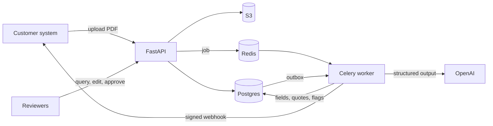

# DocFlow

**LLM extraction is easy; trusting it is the hard part.** DocFlow is an API that takes a commercial
invoice PDF, extracts its fields with an LLM, checks every value against the document and against
arithmetic and format rules, routes it through staged human approval, and notifies the customer's
system with signed webhooks.

**Live:** [API docs (Swagger UI)](https://35-154-192-199.sslip.io/docs) ·
[Integration guide](docs/integration-guide.md) · [Deployment guide](docs/deployment-guide.md) ·
[Runbook](docs/runbook.md) · [Eval results](evals/results.md) · [Design decisions](docs/decisions/)

| | |
|---|---|
| **Verified extraction** | Every field comes with the exact quote it was read from, and the quote is checked against the PDF's text. Totals, line amounts, HS codes, currencies and dates are checked in code, not by the model |
| **Measured** | Held-out eval on synthetic invoices: 100% field accuracy and 100% of planted problems caught, at about $0.0007 per invoice and 10 s median. The cheapest model matched ones 7-16x more expensive |
| **Human review** | Two approval stages with separation of duties, field-level queries back to the submitter, and an append-only audit log enforced by a Postgres trigger |
| **Integration** | Transactional outbox, HMAC-signed webhooks with retries over about 15 hours, SSRF and DNS-rebinding protection, KMS-encrypted signing secrets |
| **Production** | AWS through Terraform, deploys from GitHub Actions with OIDC (no stored keys), no SSH, nightly backups with a tested restore, one-command rollback, and a second environment rebuilt from the deployment guide |
| **Quality** | 735 tests, ruff, mypy (strict), migration drift check, Docker smoke test in CI |

## How it works



1. **Upload:** the API stores the PDF and returns `202`; a worker picks the job up.
2. **Extract:** the model returns every field with its source quote (structured output).
3. **Check:** code verifies the quotes against the PDF and runs arithmetic and format checks; failures
   become flags for the reviewer instead of silently wrong data.
4. **Review:** stage 1 and stage 2 reviewers edit, query the submitter or decide; everything is audited.
5. **Notify:** decisions are written to an outbox in the same transaction and delivered as signed
   webhooks.

## Known limitations

- Evaluated on 30 synthetic invoices, not customer data; the set is too easy to separate the models
  (details in [evals/results.md](evals/results.md)).
- API only; the demo is the Swagger UI.
- One EC2 instance runs the whole stack; the upgrade path (ECS, RDS, alarms) is in
  [decision 0007](docs/decisions/0007-aws-deployment.md).

Built as a personal project, milestone by milestone: [docs/PLAN.md](docs/PLAN.md).

## Run with Docker

```bash
cp .env.example .env
# set DOCFLOW_JWT_SECRET in .env:
python3 -c "import secrets; print(secrets.token_urlsafe(48))"

docker compose up --build
```

| Service | Role |
|---|---|
| `db` | Postgres |
| `redis` | Celery broker |
| `storage` | S3-compatible object storage (SeaweedFS) for uploaded PDFs |
| `migrate` | Runs migrations and creates the bucket once, then exits |
| `api` | FastAPI on http://localhost:8000 |
| `worker` | Celery worker that processes uploads and sends webhooks |
| `scheduler` | Celery beat: triggers webhook dispatch every 10 seconds |
| `receiver` | Mock customer system for webhooks, on http://localhost:9000/received |

The API and worker start only after `migrate` succeeds.

The worker reads `OPENAI_API_KEY` from `.env`. Without it, extraction fails with a clear reason.

`scripts/smoke_test.sh` runs an end-to-end check against a fresh stack (CI runs it too). It expects
no API key, so start the stack with `OPENAI_API_KEY= docker compose up -d --build` when running it
locally.

Create the first admin (prompts for a password):

```bash
docker compose run --rm api python -m docflow.cli create-admin --email admin@example.com
```

Open http://localhost:8000/docs, click **Authorize**, and log in with the admin's email as the
username.

## Develop locally

Python tooling runs in Linux (WSL on Windows). Native Windows is not supported: Windows
Application Control blocks the compiled extensions that SQLAlchemy and other libraries ship.
On WSL, keep the virtualenv on the Linux filesystem: reading thousands of package files through
`/mnt/<drive>` is slow enough to stall mypy.

```bash
export UV_PROJECT_ENVIRONMENT=$HOME/.venvs/docflow
docker compose up -d db redis storage       # Postgres (incl. docflow_test), Redis, object storage
uv sync
uv run alembic upgrade head
uv run uvicorn docflow.main:app --reload
```

## Checks

```bash
uv run ruff check .
uv run ruff format --check .
uv run mypy src tests alembic
uv run alembic check          # models and migrations agree
uv run pytest                 # needs the db service running; wipes only docflow_test
```

## Authentication and roles

| Role | Purpose |
|---|---|
| `submitter` | Uploads invoices, answers field queries |
| `reviewer` | Stage 1 review |
| `approver` | Stage 2, final decision |
| `admin` | Manages users |

- `POST /auth/login` takes an OAuth2 password form (`username` = email) and returns a 30-minute JWT.
- The token holds only the user id. Role and active status are read from the database on every
  request, so role changes and deactivations apply immediately.
- Admin-created users get a temporary password and can only call `/auth/me` and
  `/auth/change-password` until they change it.

See [docs/decisions/0001-production-readiness-auth.md](docs/decisions/0001-production-readiness-auth.md)
for what is production-grade and what is deliberately left out.

## Submissions

- `POST /submissions` (submitter, admin): multipart upload of one PDF, up to 10 MB. Returns
  `202` with status `uploaded`; extraction runs in the background. An optional
  `Idempotency-Key` header makes retries safe.
- `GET /submissions/{id}`: submitters see their own; reviewers, approvers and admins see all.

- `GET /submissions/{id}/attempts` (admin): every LLM call with tokens, estimated cost and latency.

Lifecycle: `uploaded -> extracting -> in_review (stage 1)` or `extraction_failed` with a
`failure_reason`, then the review workflow below. See [docs/decisions/0002-background-extraction.md](docs/decisions/0002-background-extraction.md)
for how duplicate deliveries, crashed workers and retries are handled.

## AI extraction

The worker sends the PDF to OpenAI (`gpt-6-luna` by default, `DOCFLOW_LLM_MODEL`) and gets back an
`InvoiceExtraction`: every field has a normalised `value` and the exact `source_quote` it came
from. Deterministic checks then add `flags` for a reviewer:

| Code | Meaning |
|---|---|
| `not_grounded` | The quoted text is not in the PDF, so the value may be invented |
| `grounding_unverifiable` | Scanned PDF without a text layer |
| `arithmetic_mismatch` | Line amount, subtotal or total does not add up |
| `invalid_format` | HS code, currency or date is invalid |
| `unparseable_number` | An amount is not a number |
| `missing_required` | A required field is missing |

See [docs/decisions/0003-llm-extraction.md](docs/decisions/0003-llm-extraction.md).

### Sample invoices and live test

`samples/` holds three synthetic invoices with their expected values and flags
(`uv run python scripts/make_sample_invoices.py` regenerates them). With a real key in `.env` and
a stack on which `scripts/smoke_test.sh` has run:

```bash
uv run python scripts/live_test.py   # calls OpenAI: costs real money (fractions of a cent per invoice on gpt-6-luna)
```

## Review workflow

`in_review` stage 1 (reviewer) -> stage 2 (approver) -> `approved`, or `rejected` at either stage.
Stage roles are configurable (`DOCFLOW_APPROVAL_STAGES`).

| Endpoint | Who | What |
|---|---|---|
| `GET /submissions?status=&stage=&awaiting_me=true` | everyone (submitters: own only) | Work queue, newest first |
| `PATCH /submissions/{id}/fields` | role of the current stage | Edit values with a reason; checks re-run |
| `POST /submissions/{id}/queries` | role of the current stage | Ask about specific fields -> `query_raised` |
| `POST /submissions/{id}/answers` | the submitter | Answer all open queries, optionally correcting values; back to the same stage |
| `POST /submissions/{id}/decision` | role of the current stage | `approve` (comment required if flags remain) or `reject` (reason required, final) |
| `POST /submissions/{id}/retry-extraction` | admin | Re-queue a failed or stuck submission |
| `GET /submissions/{id}/audit` | staff, and the submitter for their own | Append-only history |

Admins cannot approve or reject, and nobody can review their own submission. See
[docs/decisions/0004-review-workflow.md](docs/decisions/0004-review-workflow.md).

## Webhooks

DocFlow notifies a customer's system on `submission.approved`, `submission.rejected`,
`submission.query_raised` and `submission.extraction_failed`. Events are written to an outbox in
the same transaction as the change and sent with HMAC-SHA256 signatures, retries over about 15
hours, and SSRF protection on the target URL.

Admin endpoints: `POST/GET /webhooks`, `PATCH /webhooks/{id}`, `POST /webhooks/{id}/rotate-secret`,
`POST /webhooks/{id}/test`, `GET /webhooks/{id}/deliveries`,
`POST /webhook-deliveries/{id}/redeliver`.

For receivers: [docs/integration-guide.md](docs/integration-guide.md) (signature verification in
Python and Node.js). Design: [docs/decisions/0005-webhooks.md](docs/decisions/0005-webhooks.md).

## Evaluation

30 synthetic invoices (20 dev / 10 held-out test, 5 scanned, 13 with planted problems) across four
OpenAI configs, two repeats each. On the held-out set, the default `gpt-6-luna` reached 100% field
accuracy and caught 100% of planted problems at about $0.0007 per invoice and ~10 s median latency,
matching models 7-16x more expensive. Results, every miss, and the limitations (the dataset is too
easy to separate the models): [evals/results.md](evals/results.md).

```bash
uv run python -m evals.dataset                              # regenerate the dataset (deterministic)
uv run python -m evals.harness --run-id x --dry-run          # cost estimate before any paid run
uv run python -m evals.harness --run-id x --configs luna-medium --repeats 1   # PAID
uv run python -m evals.score evals/runs/x                    # free, re-scores saved outputs
```

## Production on AWS

DocFlow runs on AWS (`ap-south-1`): Terraform in [infra/](infra/), deploys from GitHub Actions on
every merge to `main` (OIDC, no stored AWS keys), HTTPS through Caddy, secrets in SSM Parameter
Store, webhook secrets encrypted with KMS, logs in CloudWatch, nightly backups to S3.

- [docs/deployment-guide.md](docs/deployment-guide.md): from an empty AWS account to a running deployment
- [docs/runbook.md](docs/runbook.md): deploy, roll back, logs, backups, users, secret rotation
- [docs/decisions/0007-aws-deployment.md](docs/decisions/0007-aws-deployment.md): what is production-grade, what is simplified, and the upgrade path
